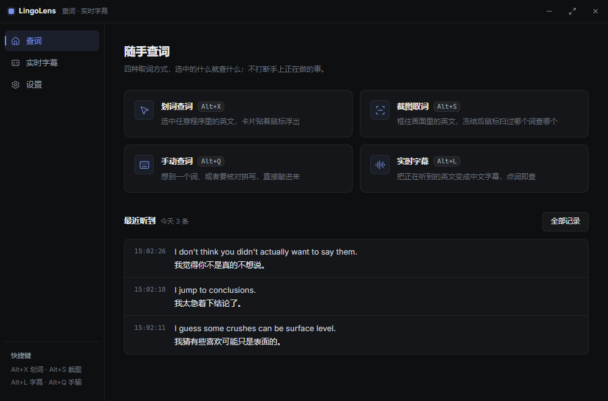
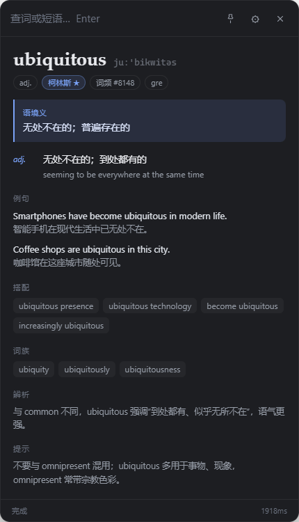
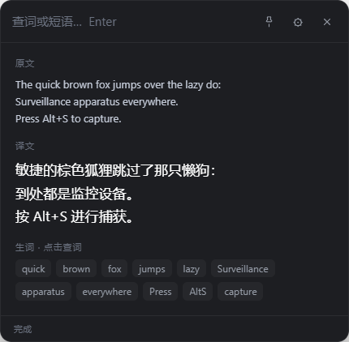
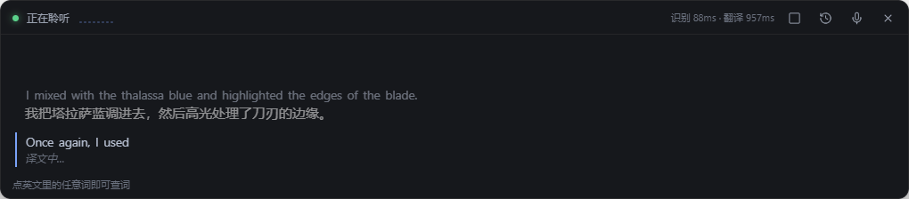

# LingoLens

<p align="center"><a href="README.md">中文</a> · <b>English</b></p>

**Instant English lookup and live captions for Windows.** Select a word anywhere — browser, game, PDF — and a card appears next to your cursor. Watching something? LingoLens turns the English you *hear* into Chinese subtitles, and every word in those subtitles is one click away from a definition.

All four entry points share a single offline dictionary and a single card UI. Explanations and translations go through the DeepSeek API.



## Features

| | Entry point | What it does |
|---|---|---|
| 🔤 | `Alt+X` Select-to-look-up | Select English text in any app. Reads the selection through UI Automation, so your clipboard is left untouched |
| 🖼 | `Alt+S` Screenshot-to-translate | Drag a box over the screen → local OCR → a translation card appears next to your selection. **No frozen image, no hovering** |
| 🎧 | `Alt+L` Live captions | Captures system audio or microphone → local faster-whisper → streaming DeepSeek translation → scrolling subtitles |
| ⌨ | `Alt+Q` Manual input | Type a word when you don't have one selected |

Also:

- **766,337-entry offline dictionary**, lookups in under 1 ms (custom binary index, no native modules)
- **Human pronunciation** — real audio MP3s from an online dictionary, with a SAPI fallback
- **Context-aware meaning** — the selected word is sent back with its sentence, so DeepSeek can answer "what does it mean *here*"
- **Every hotkey is remappable**, with a warning when a combination is already taken
- Cards never steal focus; `Esc` closes them

## Three scenarios

**Reading a page or a paper** — select a word; the card floats next to the cursor:



**Games and video** — press `Alt+S`, drag a box, and the translation appears right next to it:



**Listening to English** — scrolling subtitles. If a translation arrives late it lands in its own row instead of overwriting the current one, and every English word is clickable:



## How it works

```
Alt+X ──► selection: UIA TextPattern ─(on failure)─► simulated Ctrl+C + clipboard restore
Alt+S ──► box select ──► GDI capture ──► tesseract.js ──► word boxes
                                    │
                                    ▼
                        lookup engine (Electron main process)
                offline dictionary ‖ dictionaryapi.dev ‖ streaming DeepSeek
                                    │
                                    ▼
                              card window (HTML)

Alt+L ──► WASAPI loopback ──► VAD ──► faster-whisper (local GPU)
                                    └─► streaming DeepSeek ──► scrolling subtitles
```

Native capabilities (UIA text, screen capture, cursor position) come from a **9 KB C# helper compiled with the `csc.exe` that ships with Windows**, talking over stdin/stdout with one JSON object per line — no node-gyp, no MSVC, no .NET SDK required.

## Installation

**Requirements**: Windows 10/11 · Node.js 18+ (with pnpm) · .NET Framework 4.x (ships with Windows, provides `csc.exe`)

```bat
pnpm install
powershell -ExecutionPolicy Bypass -File tools\setup.ps1
copy config.example.json config.json
```

`setup.ps1` does three things: downloads and builds the dictionary (`data/dict.bin`), downloads the English OCR model, and compiles `native/NativeBridge.exe`.

Then put your key into `config.json` (`apiKey`, get one at [platform.deepseek.com](https://platform.deepseek.com)) and double-click `LingoLens.vbs`.

> The dictionary and the OCR model are not committed (137 MB / 2.8 MB); the setup script generates them on demand.

### Live captions (optional)

Live captions need a **separate local engine** — [Tongchuan](https://github.com/TotheMoon011215/tongchuan) (faster-whisper + VAD, Python). LingoLens talks to it over stdio. Point `speechRoot` in `config.json` at that engine's directory; leave it empty and the other three features still work.

## Hotkeys

| Default | Action | Remappable |
|---|---|---|
| `Alt+X` | Select-to-look-up | ✅ Settings |
| `Alt+S` | Screenshot-to-translate | ✅ |
| `Alt+Q` | Manual lookup | ✅ |
| `Alt+L` | Live captions | ✅ |
| `Esc` | Close card / captions | — |

## Configuration (`config.json`)

| Key | Meaning |
|---|---|
| `apiKey` | DeepSeek API key, stored locally only |
| `baseUrl` / `model` | Defaults to `https://api.deepseek.com` / `deepseek-flash` |
| `hotkeys` | Global hotkeys for the four features |
| `speechRoot` | Directory of the live-caption engine (empty = disabled) |
| `speechSource` | `system` (loopback audio) or `microphone` |

## Project layout

```
core/     lookup engine: dict.js (index queries) · dict-build.js (dictionary builder) · online.js · llm.js · ocr.js · transcript.js
shell/    Electron main process: app.js · bridge.js (native bridge) · speech.js (caption engine child process)
ui/       home (console) · index (lookup card) · live (captions) · select (box overlay) · tokens.css
native/   NativeBridge.cs (UIA / screen capture / cursor)
tools/    setup.ps1 · fetch.js (parallel downloader) · build-icons.js · make-icon.ps1
```

## Known limitations

- **Windows only** — UIA, WASAPI loopback and GDI capture are all Windows-specific
- **Exclusive-fullscreen games can't be captured**; borderless windowed mode works fine
- The OCR model is English-only, so framing Chinese text produces garbage
- Anti-cheat in competitive online games may block screen capture. LingoLens does not inject into any process, but try single-player/co-op games first
- Live captions require the external engine; without it that feature is unavailable

## Credits and licenses

| Component | Used for | License |
|---|---|---|
| [ECDICT](https://github.com/skywind3000/ECDICT) | Offline dictionary | MIT |
| [tesseract.js](https://github.com/naptha/tesseract.js) | Screen OCR | Apache-2.0 |
| [Lucide](https://lucide.dev) | Icons | ISC |
| [Inter](https://rsms.me/inter/) | UI typeface | OFL-1.1 |
| [Electron](https://www.electronjs.org) | Runtime | MIT |

Released under the **MIT** license — see [LICENSE](LICENSE).
