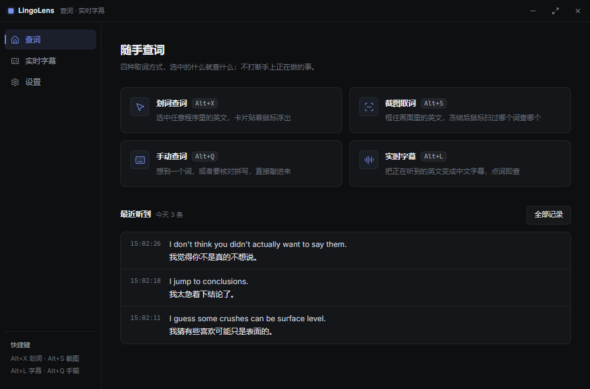
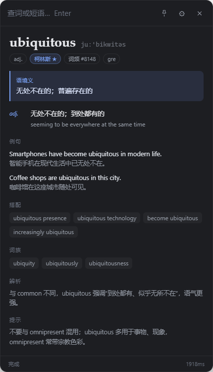
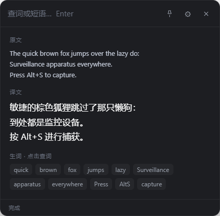
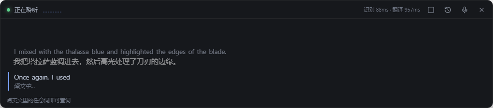

# LingoLens

<p align="center"><b>中文</b> · <a href="README.en.md">English</a></p>

**Windows 上的英文随手查 + 实时字幕。** 在浏览器、游戏、PDF 里遇到英文，一个快捷键就查清楚；听英文时，还能实时出中文字幕，字幕里的词点一下就能查。

四个入口共用一套离线词库和一套卡片界面，翻译与解释走 DeepSeek API。



## 功能

| | 入口 | 说明 |
|---|---|---|
| 🔤 | `Alt+X` 划词查词 | 选中任意程序里的英文即可查；优先读取 UI Automation 文本，不污染剪贴板 |
| 🖼 | `Alt+S` 截图取词 | 框选画面 → 本地 OCR → 直接在选区旁弹出译文卡片，**不留图、不需要悬停** |
| 🎧 | `Alt+L` 实时字幕 | 采集系统声音或麦克风 → 本地 faster-whisper 识别 → DeepSeek 流式翻译，滚动字幕 |
| ⌨ | `Alt+Q` 手动输入 | 想到一个词，直接敲 |

其他：

- **离线词库 766,337 条**，查询 < 1ms（自研二进制索引，无原生依赖）
- **真人发音**：优先在线词典的 mp3，回退 SAPI
- **语境义**：把选中的词放回所在句子，由 DeepSeek 给"它在这里是什么意思"
- **快捷键可自定义**，被占用会提示
- 卡片不抢焦点，`Esc` 关闭

## 三个场景

**读网页 / 论文** —— 划词，卡片贴着鼠标浮出：



**游戏 / 视频** —— `Alt+S` 框住画面，译文直接弹出（不需要再盯着原图悬停）：



**听英文** —— 滚动字幕，上一句的译文晚到也会落在它自己那一行；字幕里的英文单词可点击查词：



## 工作原理

```
Alt+X ──► 取词：UIA TextPattern ─(失败)─► 模拟 Ctrl+C + 还原剪贴板
Alt+S ──► 框选 ──► GDI 截屏 ──► tesseract.js ──► 生词框
                                    │
                                    ▼
                        查词引擎（Electron 主进程）
                本地词库 ‖ dictionaryapi.dev ‖ DeepSeek 流式
                                    │
                                    ▼
                              卡片窗口（HTML）

Alt+L ──► WASAPI 回环 ──► VAD ──► faster-whisper（本地 GPU）
                                    └─► DeepSeek 流式翻译 ──► 滚动字幕
```

原生能力（UIA 取词、截屏、光标位置）由一个**用系统自带 `csc.exe` 编译的 9KB C# 小进程**提供，通过 stdin/stdout 一行 JSON 通信——不需要 node-gyp、不需要 MSVC、不需要 .NET SDK。

## 安装

**环境**：Windows 10/11 · Node.js 18+（含 pnpm）· .NET Framework 4.x（系统自带 `csc.exe`）

```bat
pnpm install
powershell -ExecutionPolicy Bypass -File tools\setup.ps1
copy config.example.json config.json
```

`setup.ps1` 会做三件事：下载并生成词库 `data/dict.bin`、下载英文 OCR 模型、编译 `native/NativeBridge.exe`。

然后编辑 `config.json` 填入 `apiKey`（[platform.deepseek.com](https://platform.deepseek.com) 申请），双击 `LingoLens.vbs` 启动。

> 词库与 OCR 模型不入库（137MB / 2.8MB），由脚本按需生成。

### 实时字幕（可选）

实时字幕需要**另一个本地引擎**（[同传 · 英译中实时字幕](https://github.com/TotheMoon011215/tongchuan)，faster-whisper + VAD，Python），本项目通过 stdio 与它通信。把 `config.json` 里的 `speechRoot` 指向该引擎目录即可；不配置则其余三个功能照常可用。

## 快捷键

| 默认键 | 功能 | 可改 |
|---|---|---|
| `Alt+X` | 划词查词 | ✅ 设置页 |
| `Alt+S` | 截图取词 | ✅ |
| `Alt+Q` | 手动查词 | ✅ |
| `Alt+L` | 实时字幕 | ✅ |
| `Esc` | 关闭卡片 / 字幕条 | — |

## 配置项（`config.json`）

| 键 | 说明 |
|---|---|
| `apiKey` | DeepSeek API Key，仅保存在本地 |
| `baseUrl` / `model` | 默认 `https://api.deepseek.com` / `deepseek-flash` |
| `hotkeys` | 四个功能的全局快捷键 |
| `speechRoot` | 实时字幕引擎目录（留空 = 不用字幕） |
| `speechSource` | `system`（系统声音）或 `microphone` |

## 目录结构

```
core/     查词引擎：dict.js（索引查询）· dict-build.js（词库生成）· online.js · llm.js · ocr.js · transcript.js
shell/    Electron 主进程：app.js · bridge.js（原生桥）· speech.js（字幕引擎子进程）
ui/       home（控制台）· index（查词卡片）· live（字幕条）· select（框选层）· tokens.css
native/   NativeBridge.cs（UIA / 截屏 / 光标）
tools/    setup.ps1 · fetch.js（并行下载）· build-icons.js · make-icon.ps1
```

## 已知限制

- **仅 Windows**：UIA、WASAPI 回环、GDI 截屏都是 Windows 专有
- **全屏独占游戏截不到图**，无边框窗口化正常
- OCR 只装了英文模型，框到中文会得到乱码
- 竞技类网游的反作弊可能拦截屏幕捕获；本程序不注入进程，但仍建议先在单机/合作游戏里试
- 实时字幕依赖外部引擎，未配置时该功能不可用

## 数据来源与许可

| 组件 | 用途 | 许可 |
|---|---|---|
| [ECDICT](https://github.com/skywind3000/ECDICT) | 离线词库 | MIT |
| [tesseract.js](https://github.com/naptha/tesseract.js) | 屏幕 OCR | Apache-2.0 |
| [Lucide](https://lucide.dev) | 图标 | ISC |
| [Inter](https://rsms.me/inter/) | 界面字体 | OFL-1.1 |
| [Electron](https://www.electronjs.org) | 运行时 | MIT |

本项目以 **MIT** 许可发布，见 [LICENSE](LICENSE)。
